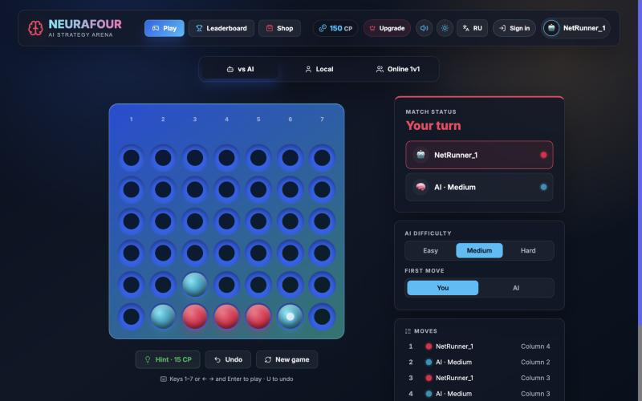

# NeuraFour

[](https://github.com/Vinbe0/neurafour/actions/workflows/ci.yml) [](https://github.com/Vinbe0/neurafour/actions/workflows/deploy.yml)

**Connect Four with a search engine that looks 14+ moves ahead, real-time online play, and a coach that reviews your game.**

**▶ Play it: [vinbe0.github.io/neurafour](https://vinbe0.github.io/neurafour/)**  ·  [Русская версия](README.ru.md)



## Features

- **AI opponent, four levels.** Easy looks 2 moves ahead (with some random play), Medium 4, Hard 6, and Expert searches as deep as it can in 750 ms, usually 14+ moves. The search runs in a Web Worker, so the page never freezes while the AI thinks.
- **Online multiplayer.** Create a room, share the invite link, and play a friend in real time over WebSockets, with chat and rematches. Reloading the page drops you back into the same game.
- **AI Coach.** After each game, every move is graded (perfect / great / good / mistake / blunder) against the engine's best move. The coach points out missed wins, missed blocks and moves that handed your opponent a win.
- **Accounts and leaderboard.** Supabase auth, with a global and per-city leaderboard and match history. Scores are computed in the database, not trusted from the browser ([details](#leaderboard-security)). It works offline too, using a localStorage cache.
- **Progression.** Levels, CyberPoints, a skin shop, and a PRO tier prototype.
- **English / Russian interface.** A full translation system with a one-click switch. It remembers your choice and defaults to your browser's language.
- **Play your way.** Keyboard controls (`1`–`7`, or `←`/`→` + `Enter`, and `U` to undo), undo, a choice of who moves first against the AI, a live move list, and a ghost preview of where your token will land.
- Dark/light theme, responsive layout down to phone width, sound effects, a highlighted winning line, and in-app notifications. Animations are reduced if your system asks for less motion.

## How the AI works

[`src/engine.ts`](src/engine.ts) is a game-tree search built for speed:

1. **Negamax with alpha-beta pruning.** It tries center columns first (`3, 2, 4, 1, 5, 0, 6`), which lets pruning skip far more branches. A win found sooner scores higher than a win found later.
2. **Transposition table.** The same position is often reached by different move orders. Each position gets a 53-bit **Zobrist hash**, and its score and best move are stored in a table so they are never searched twice.
3. **Iterative deepening with a time limit.** Expert searches 1 move ahead, then 2, then 3, and so on, until its 750 ms budget runs out, and plays the best move from the deepest finished search. The table makes each round much faster than the last.
4. **Incremental evaluation.** The board lives in typed arrays that are updated in place. When a token is played, only the (at most 13) four-cell lines through that cell are re-scored, instead of the whole board.

On an empty board it reaches 12 moves ahead in about 60 ms and 14 in about 250 ms. The tests check it against a plain minimax: same scores at every depth on hundreds of random positions.

[`src/ai.ts`](src/ai.ts) adds tactical checks on top (take a win, block a loss) and the **AI Coach**, which compares each move you played with the engine's recommendation and the score before and after. Searches run in a **Web Worker** ([`src/ai.worker.ts`](src/ai.worker.ts)), falling back to the main thread if workers are unavailable.

## Multiplayer architecture

```
Browser ──WebSocket──▶ Node server (TypeScript, Express + ws)
                        • rooms keyed by 5-letter code
                        • server owns the board, move list and turn order
                        • validates every move with the same rules module as the browser
                        • holds a disconnected player's seat for 30 s so they can rejoin
```

The server ([`server/app.ts`](server/app.ts)) is authoritative. It rejects moves made out of turn, moves into full or invalid columns, and moves after the game ends, so a modified client can't cheat. It shares [`src/rules.ts`](src/rules.ts) with the browser instead of keeping its own copy, and limits names and chat messages. Each player gets a secret token. After a page reload, the browser uses it to take the seat back and receives the moves and chat so far. `GET /health` reports how many rooms are active.

## Tech stack

React 19 · TypeScript · Vite · Web Workers · Node.js · Express · `ws` · Supabase (Postgres, Auth, row-level security, PL/pgSQL) · Vitest · Playwright · GitHub Actions

## Testing

| Command | What it covers |
| --- | --- |
| `npm test` | 61 unit tests (Vitest): board rules, the search engine against a reference minimax, AI strength by self-play, the game state module, the AI Coach, and the multiplayer server driven by real WebSocket clients |
| `npm run test:e2e` | Playwright in Chromium: playing the AI with undo, a keyboard-only game, the coach review, language and theme, every dialog, and two browsers playing an online game, including one reloading mid-game |
| `npm run test:db` | The Supabase schema and scoring migration on a real Postgres database, including attempts to cheat |

[CI](.github/workflows/ci.yml) runs all three on every pull request, and the deploy runs the unit tests again before publishing.

## Running locally

```bash
npm install
npm run dev        # Vite client + WebSocket server on :5001 (Node 22.18+)
```

**Play online locally:** open http://localhost:5173 in two browser windows. In one, choose **Online 1v1 → Create room** and copy the invite link. Open the link in the other window and press **Join**.

**Play with someone on the same Wi-Fi:** run `npm run dev:lan` and give them the `Network:` address it prints (for example `http://192.168.1.20:5173`). Their browser connects to the multiplayer server on your machine. macOS may ask you to allow incoming connections for Node.

Optional settings in `.env.local`:

```env
VITE_SUPABASE_URL=...
VITE_SUPABASE_PUBLISHABLE_KEY=...
VITE_WS_URL=wss://your-server.example.com   # defaults to ws://<host>:5001
```

To turn on the real leaderboard, run [`supabase/schema.sql`](supabase/schema.sql) in the Supabase SQL editor, then each file in [`supabase/migrations/`](supabase/migrations/) in order.

### Leaderboard security

Signed-in players cannot write their own score. They can only edit their name, city and avatar; points and stats change only through database functions ([migration](supabase/migrations/20261026000000_server_side_scoring.sql)):

- `record_match` computes the points for a result itself, ignores local two-player games, allows one result every 20 seconds and caps earnings at 600 points a day
- `spend_points` charges server-side prices for hints and skins and refuses to overspend
- `activate_pro` turns on the (free, demo) PRO plan

Results are still reported by the browser, since the server does not replay games against the AI, so these limits bound what a cheater can gain rather than make cheating impossible.

`npm run test:db` checks all of this against a real Postgres database (`DATABASE_URL` must point to a server where it can create a throwaway database). CI runs it on every pull request.

## Deployment

- **Frontend:** GitHub Pages, deployed by [`.github/workflows/deploy.yml`](.github/workflows/deploy.yml) on every push to `main`. The workflow reads the `VITE_*` values from the repo's Actions variables.
- **Multiplayer server:** Render, defined in [`render.yaml`](render.yaml) (free web service, health check on `/health`).
